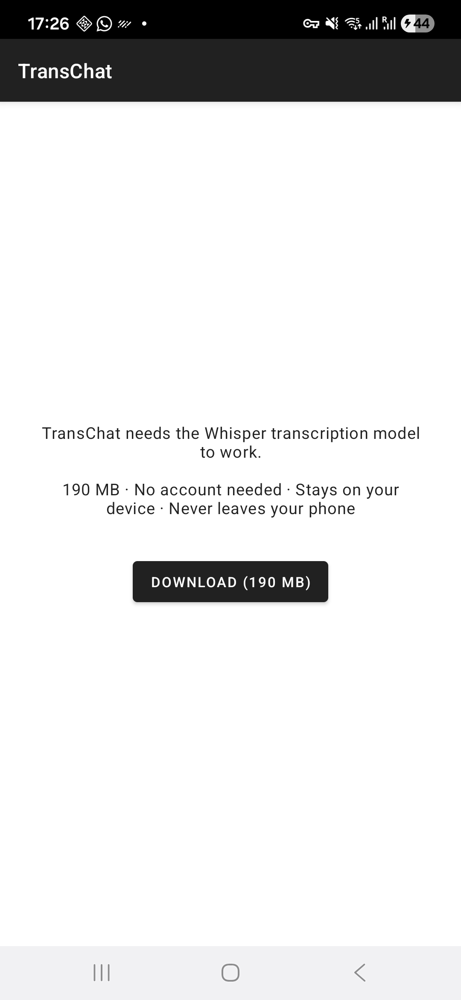
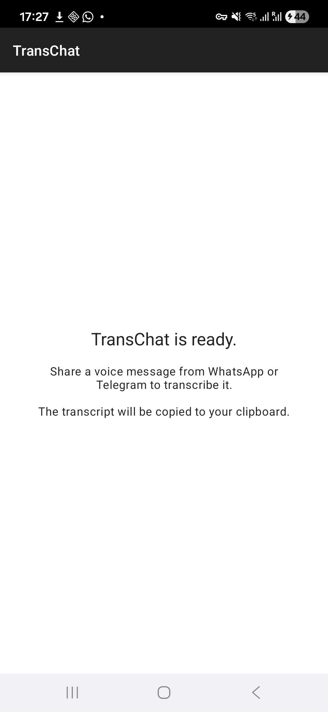
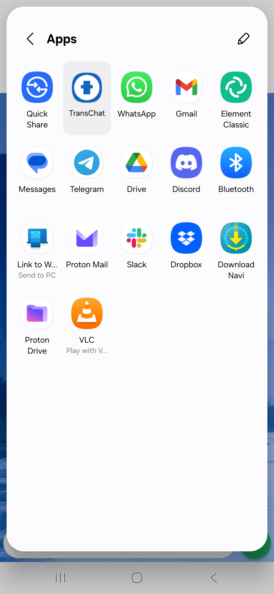
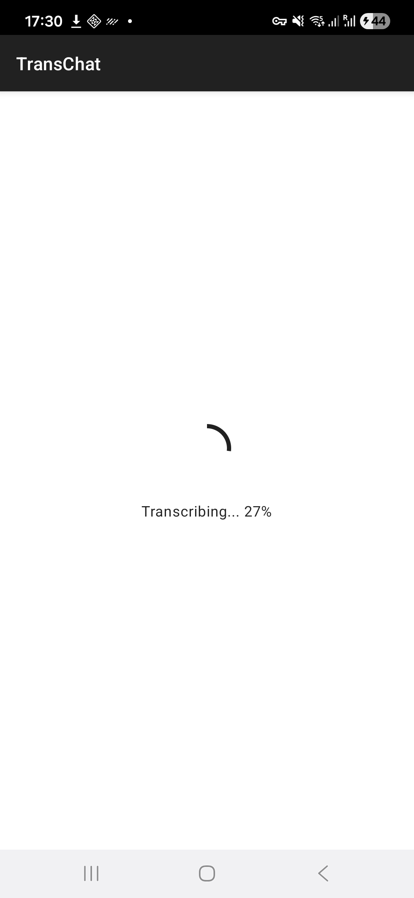
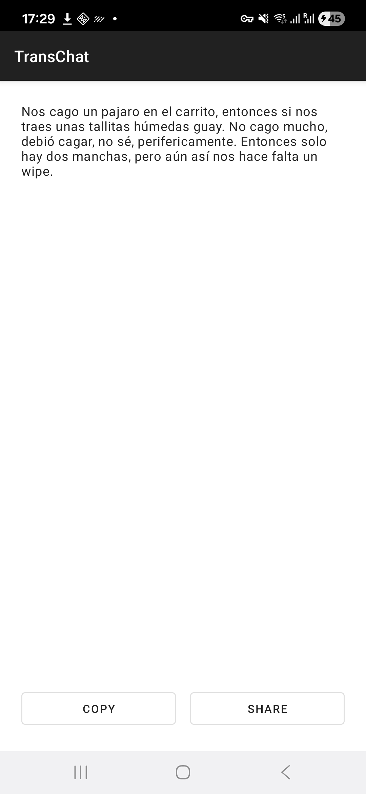

# TransChat

Transcribe shared voice messages locally and privately — no cloud, no data leaks.

## Features

- Share target for WhatsApp, Telegram, and any app that shares audio files
- On-device transcription using whisper.cpp (no internet required)
- Multilingual support (auto-detects language, tested with Spanish)
- Real-time progress bar during transcription (0-100%)
- Copy and Share buttons for the transcript result
- Anti-hallucination filtering for silent/noise audio
- Privacy-first: zero network permissions declared in manifest
- Small footprint: ~5.4 MB APK (arm64-v8a release build)

## Privacy

TransChat has zero network permissions — not even INTERNET is declared in the manifest, except for the one-time model download. Audio never leaves the device. There is no analytics, no telemetry, and no tracking of any kind. The model download is the only network operation and happens once over WiFi by default. Transcripts are ephemeral — they are never stored on disk.

## Screenshots

| Model Download | Ready State | Share Target | Progress Bar | Result |
|:-:|:-:|:-:|:-:|:-:|
|  |  |  |  |  |

## How It Works

1. Share a voice message from WhatsApp, Telegram, or any messaging app
2. TransChat decodes the audio (OGG/Opus, MP3) via Android MediaCodec
3. Audio is resampled to 16kHz mono for Whisper
4. whisper.cpp runs on-device inference using the small multilingual model
5. Post-processing filters hallucinations from silent/noise segments
6. Read, copy, or share the transcript

## Building from Source

### Prerequisites

- Android Studio Ladybug (2024.2) or later
- Android SDK with compileSdk 34
- Android NDK 26.1.10909125 (install via SDK Manager)
- CMake 3.22.1 (install via SDK Manager)
- Git (for submodule checkout)

### Steps

```bash
git clone --recurse-submodules https://github.com/spenap/transchat-app.git
cd transchat-app
```

If you already cloned without submodules:

```bash
git submodule update --init --recursive
```

Open the project in Android Studio, sync Gradle, select an arm64-v8a device or emulator, and run.

Or build from the command line:

```bash
./gradlew assembleDebug
```

The debug APK will be at `app/build/outputs/apk/debug/app-debug.apk`.

## Tech Stack

| Component | Version |
|-----------|---------|
| whisper.cpp | v1.7.4 |
| Whisper model | small multilingual q5_1 (~190 MB) |
| Kotlin | 2.0.21 |
| Gradle / AGP | 8.9 / 8.7.3 |
| NDK | 26.1 (r26) |
| compileSdk / targetSdk | 34 |
| minSdk | 26 (Android 8.0) |

## License

This project is licensed under the MIT License — see the [LICENSE](LICENSE) file for details.
