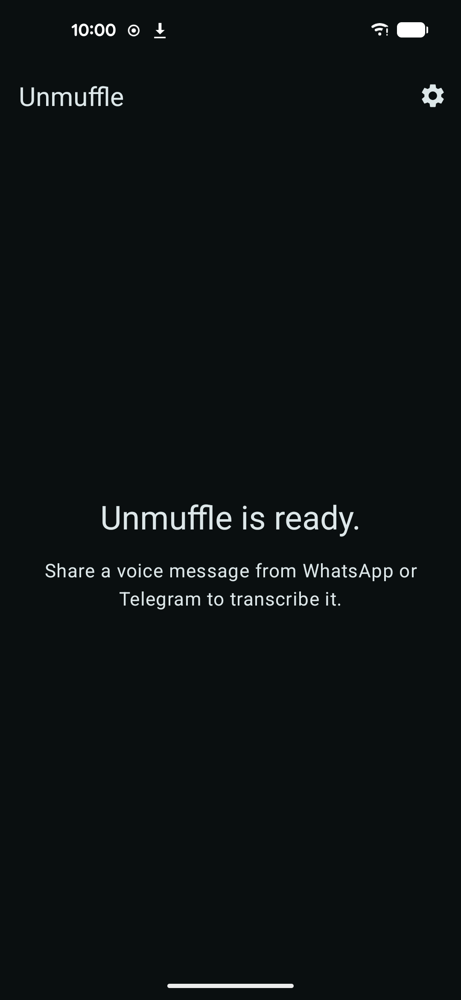
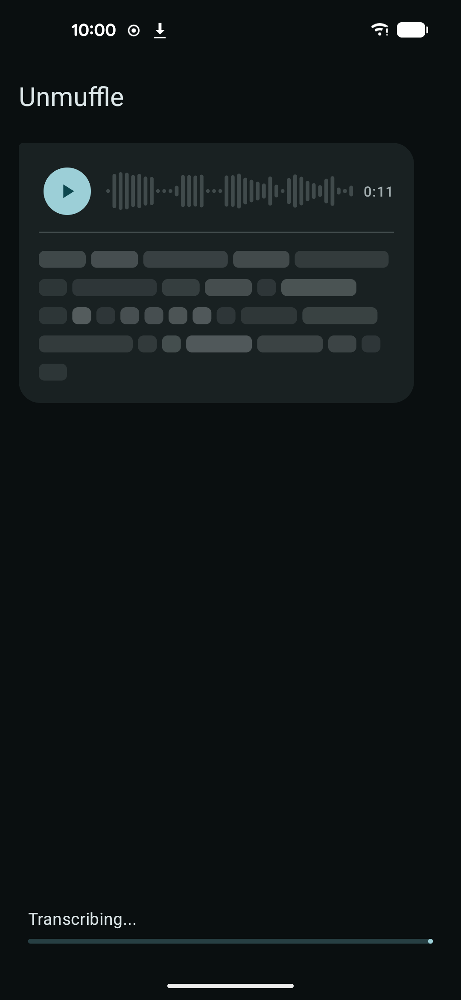
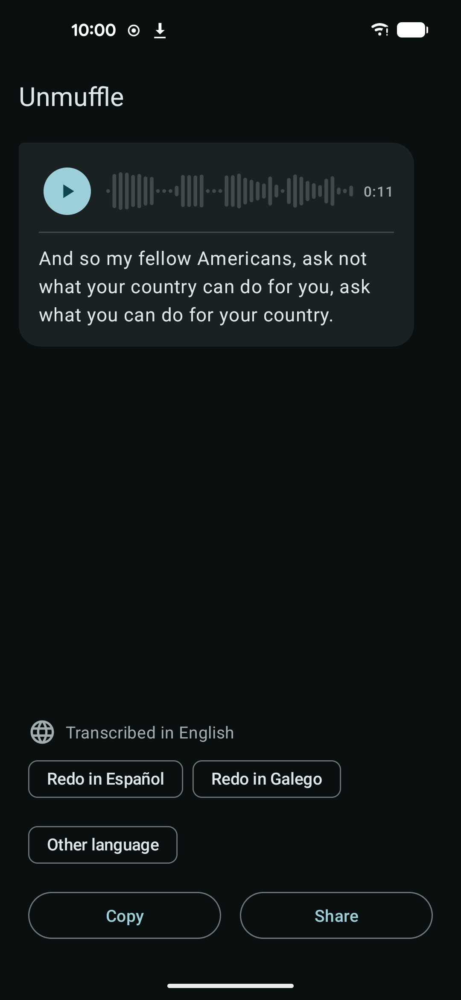

# Unmuffle

Read your voice messages instead of listening to them. Share a voice
message from WhatsApp, Telegram or any app to Unmuffle, and it transcribes
it on your phone with [whisper.cpp](https://github.com/ggml-org/whisper.cpp).

Written with AI: [Claude Code](https://claude.com/claude-code) writes the
code, I direct it and test it on my phones. Each release can be rebuilt
from its tag and compared (`scripts/repro-check.sh`).

| Home | Transcribing | Transcript |
|:-:|:-:|:-:|
|  |  |  |

## How it works
1. The first time, Unmuffle downloads the Whisper model, or takes it from
   a file you pick, and checks it.
2. You share a voice message to Unmuffle.
3. The words appear as they are transcribed, under a player for the audio.
   Words Whisper is unsure of are marked.
4. Copy or share the transcript. If the language was wrong, transcribe it
   again in another one.

The transcription language is the phone's own unless you choose another,
or auto-detect, in Settings.

## Privacy
- Audio and transcripts stay on the phone. The audio is deleted when you
  leave the transcript; transcripts are never written to disk or logged.
- The only permission is Internet, used once to download the model from a
  fixed address, checked against its known SHA-256.
- No accounts, analytics, ads or Google Play Services.

## Building
Android SDK, JDK 17, and the NDK and CMake versions in
`app/build.gradle.kts`.

```bash
git clone --recurse-submodules https://github.com/spenap/unmuffle.git
cd unmuffle
./gradlew assembleDebug
```

How the code fits together: `docs/architecture.md`. Plans, decisions and
measurements: `docs/`.

## License
MIT — see [LICENSE](LICENSE).
