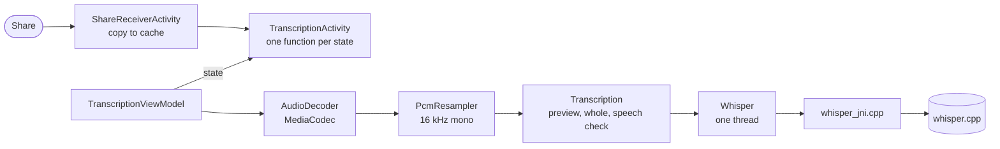

# Architecture

One flow: a shared voice message becomes text on the screen.

Words reach the screen as whisper decodes them: the native callback
writes each segment's tokens, `Whisper` polls them every 200 ms,
`TokenWords` turns tokens into words and `StreamingTranscript` into the
text so far.

## Files
Screens
- `MainActivity`: Home: getting the model (download or file), then how to share.
- `ShareReceiverActivity`: the share target; copies the audio, opens the transcript.
- `TranscriptionActivity`: the player, the text as it grows, the result.
- `SettingsActivity`, `LanguagePickerActivity`: the language; model, licences, version.

Transcription
- `TranscriptionViewModel`: loads the model, decodes the audio, runs a transcription; survives rotation.
- `Transcription`: the pipeline (preview, whole message, speech check) behind `Recognizer`.
- `FirstChunk`: where the preview ends and its encoder window.
- `StreamingTranscript`: the text so far, unsure words, words still to come.
- `TokenWords`: the native segment bytes as words with their certainty.
- `HallucinationFilter`: tells speech from whisper's output on silence.
- `Whisper`, `WhisperLib`, `cpp/whisper_jni.cpp`: the model, its thread, the JNI.
- `WhisperCpuConfig`: how many threads.

Audio
- `AudioCopier`: the shared file into the cache, and clearing it.
- `AudioDecoder`, `PcmResampler`: any audio file to 16 kHz mono floats.
- `PcmPlayer`, `Waveform`, `WaveformView`: playing and seeking.

Model and settings
- `WhisperModel`, `ModelManager`, `DownloadViewModel`: the model files, download and check.
- `ModelFile`: copying and checking a picked model file; when a download has stalled.
- `SettingsRepository`, `Languages`: the language setting and language names.
- `PlaceholderText`: the twinkling blocks for words still to come.

## Tests
- JVM (`app/src/test`): the pipeline with a fake recognizer, and each pure
  piece above. `./gradlew testDebugUnitTest`.
- Phone (`app/src/androidTest`): Home, the CPU backend, share → transcript
  with the tiny model. `scripts/device-test.sh`.
- Speed and text on real messages: `scripts/bench.sh`, results in
  `docs/measurements.md`.
